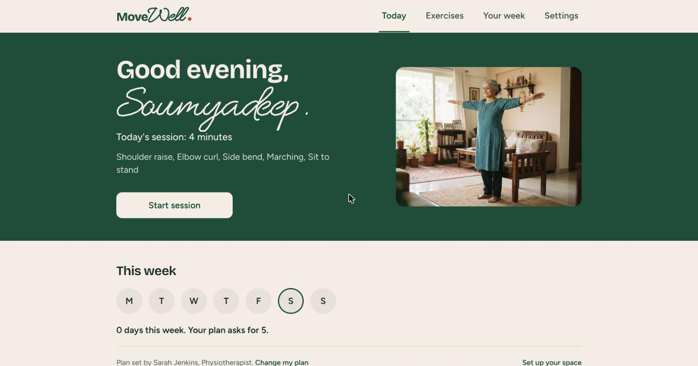
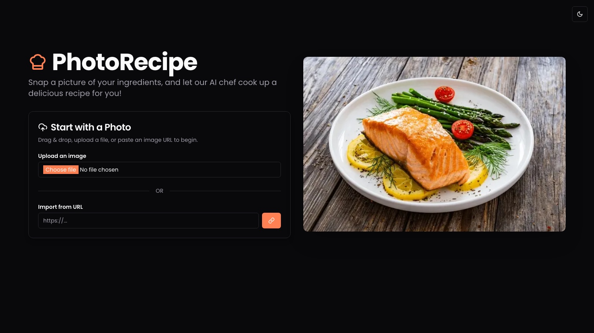

 

### Hi, I'm Soumyadeep. I turn "it works on my machine" into "it works."

Cargo that moves, beds that rest, minds that heal, buildings that stand. I've written software for all four.

These days I'm at [Infocusp](https://www.infocusp.com), on a building design product I joined when it was a blank page. It helps builders and architects choose sites and design compliant site plans. I own its backend architecture and data model, and I lead the engineers who build it. I started on the frontend and drifted to the backend, so most of my time now goes into how data is shaped and how systems are run.

When universities invite me, I go back and teach what I wish someone had shown me: C++, cloud, problem solving and competitive programming.

<table>
  <tr>
    <td align="center" width="25%"><h3>3 years</h3>building software</td>
    <td align="center" width="25%"><h3>700+</h3>LeetCode problems solved</td>
    <td align="center" width="25%"><h3>4 talks</h3>at universities</td>
    <td align="center" width="25%"><h3>Top 1%</h3>of my university class</td>
  </tr>
</table>

## Things I've built

<table>
  <tr>
    <td width="50%" valign="top">
      
      <h3><a href="https://soumyadepp.github.io/neurosim/">NeuroSim</a></h3>
      An interactive brain simulator that shows how dementia spreads through a real map of the human brain, checked against published patient data.
        
      TypeScript · Vite &nbsp;|&nbsp; <a href="https://soumyadepp.github.io/neurosim/">Try it</a> · <a href="https://github.com/soumyadepp/neurosim">Code</a>
    </td>
    <td width="50%" valign="top">
      
      <h3><a href="https://soumyadepp.github.io/movewell/">MoveWell</a></h3>
      Gentle, camera-guided exercise for older adults. It watches each movement through the camera and talks you through it, in English or Hindi.
        
      Svelte · MediaPipe · TypeScript &nbsp;|&nbsp; <a href="https://soumyadepp.github.io/movewell/">Try it</a> · <a href="https://github.com/soumyadepp/movewell">Code</a>
    </td>
  </tr>
  <tr>
    <td width="50%" valign="top">
      
      <h3><a href="https://github.com/soumyadepp/popsub">PopSub</a></h3>
      A real-time pub/sub server over WebSockets with topic routing and at-least-once delivery. Small enough to read in an afternoon.
        
      Rust · Tokio · WebSocket · sled &nbsp;|&nbsp; <a href="https://soumyadepp.com/blogs/building-popsub">How I built it</a> · <a href="https://github.com/soumyadepp/popsub">Code</a>
    </td>
    <td width="50%" valign="top">
      
      <h3><a href="https://photorecipe-lilac.vercel.app/">PhotoRecipe</a></h3>
      Photograph your ingredients and get a complete, editable recipe in seconds. A vision model reads the photo and writes a recipe around it.
        
      Next.js · Gemini · Genkit · Firebase &nbsp;|&nbsp; <a href="https://photorecipe-lilac.vercel.app/">Try it</a> · <a href="https://github.com/soumyadepp/PhotoRecipe">Code</a>
    </td>
  </tr>
</table>

Also: a [benchmark](https://github.com/soumyadepp/benchmark-json-toon-vsc) of what the same data costs a language model as JSON, TOON or VSC, and an open [system design repo](https://github.com/soumyadepp/grok-system-design) where people submit and review HLD and LLD proposals.

## Writing

- [The hidden line item on your AI bill](https://soumyadepp.com/blogs/the-hidden-line-item-on-your-ai-bill)
- [Building PopSub: a pub/sub broker small enough to read in an afternoon](https://soumyadepp.com/blogs/building-popsub)
- [The borrow checker isn't your enemy. It's the senior dev you never had.](https://soumyadepp.com/blogs/understanding-rust-ownership)
- [Why your code doesn't need to be fast, yet](https://soumyadepp.com/blogs/why-your-code-doesnt-need-to-be-fast-yet)
- [What every Python developer should know about `__slots__`](https://soumyadepp.com/blogs/python-slots-memory-optimization)

## On stage

| Talk | Where | |
|---|---|---|
| [Introduction to STL](https://soumyadepp.com/talks/charusat-stl) | Charusat University | 2026 |
| [Cloud basics, AWS and chaos engineering](https://soumyadepp.com/talks/ddu-cloud) | Dharmsinh Desai University | 2026 |
| [Problem solving, DSA and interview prep](https://soumyadepp.com/talks/cspit-dsa) | Charusat University | 2025 |
| [Competitive programming](https://soumyadepp.com/talks/cspit-cp) | Charusat University | 2025 |

I also hosted TEDxPrahladnagar, which is where I learned to hold a room.

## What I work with

**Backend** &nbsp; Python, FastAPI, Rust, Node.js, Ruby on Rails 
**Frontend** &nbsp; TypeScript, React, Next.js, Svelte, Flutter 
**Cloud** &nbsp; Google Cloud Run, Firestore, BigQuery, AWS, Docker, Terraform

## Say hello

[soumyadepp.com](https://soumyadepp.com) · [LinkedIn](https://www.linkedin.com/in/soumyadeep-ghosh-90a1951b6/) · [ghoshsoumyadeep330@gmail.com](mailto:ghoshsoumyadeep330@gmail.com)

Away from the keyboard: guitar, keyboard, basketball, cricket, a little sketching, and cooking things I have never cooked before.
