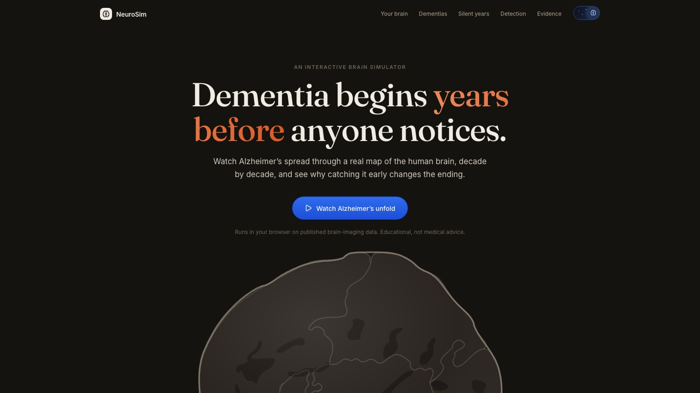

 

### Hey, I'm Soumyadeep.

I build products end to end, from the database schema to the button you click, and I have opinions about both.

My day job is a building design platform I've worked on since its first commit. The side projects below are where I try the ideas my day job would never approve.

## Things I built because nobody stopped me

<table>
  <tr>
    <td width="50%" valign="top">
      
      <h3><a href="https://soumyadepp.github.io/neurosim/">NeuroSim</a></h3>
      Watch dementia spread through a real map of the human brain. It's the kind of thing a paper describes in forty pages; here you just press play. The model is checked against published patient data.
        
      TypeScript · Vite &nbsp;|&nbsp; <a href="https://soumyadepp.github.io/neurosim/">Try it</a> · <a href="https://github.com/soumyadepp/neurosim">Code</a>
    </td>
    <td width="50%" valign="top">
      
      <h3><a href="https://soumyadepp.github.io/movewell/">MoveWell</a></h3>
      Exercise for older adults that doesn't assume they love apps. It watches through the camera and talks them through each move, in English or Hindi. Big buttons, no jargon, no tiny grey text.
        
      Svelte · MediaPipe · TypeScript &nbsp;|&nbsp; <a href="https://soumyadepp.github.io/movewell/">Try it</a> · <a href="https://github.com/soumyadepp/movewell">Code</a>
    </td>
  </tr>
  <tr>
    <td width="50%" valign="top">
      
      <h3><a href="https://github.com/soumyadepp/popsub">PopSub</a></h3>
      A pub/sub broker in Rust, small enough to read in an afternoon. Messages go only to the people who asked for them, and get retried until someone says thanks.
        
      Rust · Tokio · WebSocket · sled &nbsp;|&nbsp; <a href="https://soumyadepp.com/blogs/building-popsub">How I built it</a> · <a href="https://github.com/soumyadepp/popsub">Code</a>
    </td>
    <td width="50%" valign="top">
      
      <h3><a href="https://photorecipe-lilac.vercel.app/">PhotoRecipe</a></h3>
      Show it what's in your kitchen and it writes dinner. A vision model reads the photo, names the ingredients and turns them into a recipe you can edit.
        
      Next.js · Gemini · Genkit · Firebase &nbsp;|&nbsp; <a href="https://photorecipe-lilac.vercel.app/">Try it</a> · <a href="https://github.com/soumyadepp/PhotoRecipe">Code</a>
    </td>
  </tr>
</table>

Also lying around: a [benchmark](https://github.com/soumyadepp/benchmark-json-toon-vsc) that measures whether JSON, TOON or VSC is cheaper to feed a language model (it matters more than you'd think), and a [system design repo](https://github.com/soumyadepp/grok-system-design) where people submit designs and other people politely tear them apart.

## Elsewhere

[soumyadepp.com](https://soumyadepp.com) · [Writing](https://soumyadepp.com/blogs) · [LinkedIn](https://www.linkedin.com/in/soumyadeep-ghosh-90a1951b6/) · [Email](mailto:ghoshsoumyadeep330@gmail.com)
